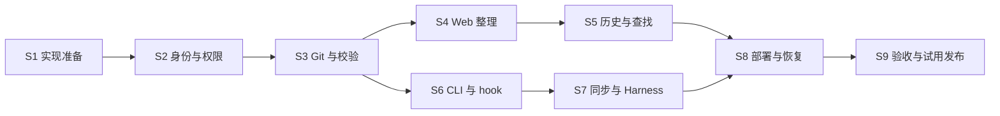

# Notegit 企业知识库 Roadmap

版本：v1.0 规划草案。基线：[架构设计 v0.2](../../../architecture.md)。本文件负责产品范围、阶段依赖和完成标准；架构文档负责系统设计。发生冲突时先追加决策并同步两份文档，不由实现者静默选择。

当前只有设计文档，没有实现代码；所有 sprint 均为 planned，未开始开发。本文中的角色、交付默认值和排序是规划建议，用户明确确认的产品要求见架构 §1.1。

Roadmap 分为第一版必须交付的 E1 和试用后按证据启动的后续方向。后续方向不属于 E1 的关闭条件，立项时各自生成 epic。Sprint 按价值和完成标准划分，不代表固定周数。

## Deliverables

### 产品目标

企业独立部署 Notegit，员工通过网页主动整理企业知识；不同 Harness 以当前员工身份通过原生 Git 读取、修改和同步知识。知识覆盖任意企业工作，库不区分类型，按成员和分支规则授权，不统一强制 PR。

第一版成功的完整路径：管理员部署 → 建库并邀请成员 → 员工整理 Markdown → Agent clone 并读取 → 人或 Agent 修改 → 格式校验 → 授权发布 → 双方看到同一版本 → 可查看历史并恢复。

### 第一版交付清单

| ID | 交付物 | 范围与结果 | 优先级 | 日期 / 依据 |
|---|---|---|---|---|
| F01 | 独立部署包 | 单实例、持久存储、HTTPS 接入说明、首次管理员初始化 | P0 | 2026-10-12；架构 §10 |
| F02 | 员工身份与凭据 | 本地账号、邀请、登录会话、员工名下可过期可撤销的 Git 凭据 | P0 | 2026-10-12；架构 §4.1 |
| F03 | 库与成员管理 | 私有库、稳定 ID、唯一 slug、阅读/编辑/管理员、主干写入限制 | P0 | 2026-10-12；架构 §4.2–4.3 |
| F04 | Git HTTPS 服务 | 原生 clone/fetch/push、分支管理、非快进拒绝、读写授权 | P0 | 2026-10-12；架构 §3.2、§4.3 |
| F05 | 统一内容校验 | Schema、路径与容量规则、逐提交检查、结构化错误、规则版本 | P0 | 2026-10-12；架构 §5 |
| F06 | 人类知识整理入口 | 目录、预览、元数据表单、Markdown 编辑、上传、重命名、删除 | P0 | 2026-10-12；架构 §6 |
| F07 | 草稿与并发保护 | 私有草稿、base commit、冲突保留、Web/Git 共享发布规则 | P0 | 2026-10-12；架构 §6 |
| F08 | 历史与查找 | 提交历史、文档 diff、以新提交还原、标题/标签/摘要查找 | P0 | 2026-10-12；架构 §6、§9 |
| F09 | Agent 辅助 CLI | login、ls --json、setup、lint；不要求包装 commit/push | P0 | 2026-10-12；架构 §8 |
| F10 | 安全同步与 Harness 指引 | 库发现、完整克隆、安全快进、逐库结果、本地/托管两种接入 | P0 | 2026-10-12；架构 §7 |
| F11 | 审计与恢复 | 真实认证主体、写入结果核对、监控、备份、恢复、升级说明 | P0 | 2026-10-12；架构 §4.4、§10 |
| F12 | 企业试用与发布材料 | 验收证据、用户/管理员/Harness 文档、已知限制、试用反馈 | P0 | 2026-10-12；架构 §11–12 |

P0 表示第一版必须交付，不代表所有任务同时启动。目录排序、富文本、收藏、自动摘要等体验增强不能挤占权限、数据一致性和恢复能力。

### 里程碑与发布边界

| 里程碑 | 用户能获得什么 | 组成 | 发布定位 | 日期 / 依据 |
|---|---|---|---|---|
| M0：实现准备完成 | 有可执行的技术方案与契约 | S1 | 可开始正式实现，不算产品完成 | 2026-10-12；D3、D9 |
| M1：Git 闭环 | 员工按权限用原生 Git 读写合规知识 | S2、S3 | 内部技术验证 | 2026-10-12；架构阶段 A |
| M2：人类整理闭环 | 人可网页整理，Git 与网页互相可见 | S4、S5 | 内部产品验证 | 2026-10-12；架构阶段 B |
| M3：Harness 闭环 | 本地和托管 Harness 可发现、读取、修改、同步 | S6、S7 | 功能候选版，尚需恢复与试用验证 | 2026-10-12；架构阶段 C |
| M4：企业可试用 v0.1 | 可部署、可维护、可恢复，完整工作流经验证 | S8、S9、全部 E1 DoD | 第一版试用发布 | 2026-10-12；D4、D8 |

M1/M2 可以内部演示，但不得以阶段演示替代 M4 发布条件。S8 的备份与恢复不等到交付前才设计，S1 就确定其契约，S8 完成落地和演练。

### 后续演进（按需求触发）

| 方向 | 候选能力 | 启动证据与依赖 | 交付判断 | 日期 / 依据 |
|---|---|---|---|---|
| 企业治理 | SSO、账号停用联动、分支审核、提案 diff/批准/驳回/合并 | 试用企业明确需要身份生命周期或审核；依赖 F02–F07、F11 | 离职或撤权阻断后续访问；开启审核时网页和 Git 均不能绕过；未开启的库仍可直接提交 | 2026-10-12；架构阶段 D、D6 |
| 知识整理增强 | Word/PDF/TXT 转换、批量导入、AI 摘要和来源提取 | 企业有真实样本文档和整理成本反馈；依赖 F05–F08 | 样本转换保留结构与附件；失败可见；预览确认后正式入库；AI 结果可修改 | 2026-10-12；架构 §6、D7 |
| 接入与查找增强 | 只读 MCP、在线查询、正文搜索、可选语义检索 | Harness 或知识规模证明 Git 文件读取与元数据查找不足；依赖 F02–F05、F08、F10 | 所有接口按员工权限过滤，引用可定位到版本，索引可重建；原生 Git 保持可用 | 2026-10-12；架构 §8、D7 |
| 运维与规模增强 | 性能优化、大附件策略、SSH、Git LFS、多实例、知识巡检 | 基准与容量监控显示具体瓶颈；依赖 F01、F04、F11 | 用明确基准证明改善；并发写入与备份仍正确；部署复杂度可说明 | 2026-10-12；架构 §9–10、D7 |

后续方向没有默认日期或已承诺版本号。每项启动前补真实需求、范围、DoD 和依赖，不因为列入表格就自动开始实现。知识巡检只提示过期或缺来源，不承诺自动判断事实正确性。

### 第一版明确排除

不做强制所有提交走 PR、不创建独立 Agent 权限体系、不依赖企业外部 Git 平台、不建设 Harness 或任务执行引擎。不提供文档级访问权限、通用 Git 项目平台、CI、完整富文本编辑、自动后台提交、正文/语义搜索、SSO、复杂格式转换、Git LFS 或高可用承诺。

## Definition of Done

以下是 E1 的正式完成清单；不能因为任一 sprint 完成就提前关闭 E1。全部条件满足并附验收证据后才能发布第一版。后续修改 DoD 必须在本文件追加修订决策。

- [ ] **DOD-01 独立部署**：在全新目标环境按文档启动 Notegit、完成管理员初始化；不依赖外部 Git 平台，重启后账号、权限、知识和历史仍存在。
- [ ] **DOD-02 身份与权限**：至少两个员工、两个不同成员集的库验证 Web/API/Git 一致授权；无权库、历史、附件、refs、对象和搜索结果不可访问；只读成员不能写入。
- [ ] **DOD-03 员工凭据**：Agent 凭据归属当前员工；凭据到期、撤销、账号停用或成员撤权阻断后续请求；服务端审计以认证主体为准，不信任可填写的 commit 作者身份。
- [ ] **DOD-04 原生 Git**：标准 Git 客户端可 clone/fetch/commit/push；允许编辑者直接快进发布的库无需 PR；默认分支保护、禁止 force push/删除及 ref 范围规则真实生效。
- [ ] **DOD-05 内容校验**：暂存区、服务端和网页使用同一规则契约；无效 Schema、危险 tree 条目、超限输入被阻止；跳过本地 hook、先写坏内容再删除、合并提交和多 ref 推送均不能绕过规则。
- [ ] **DOD-06 Web 整理**：员工能浏览、编辑、上传 Markdown 与图片、重命名和删除；必填元数据有清楚提示；预览和附件遵循内容及访问限制。
- [ ] **DOD-07 草稿与并发**：私有草稿可恢复；网页与 Git 并发或两次网页提交冲突时不静默覆盖，冲突草稿保留；发布使用预期旧 commit 检查和统一权限规则。
- [ ] **DOD-08 历史与查找**：Web 与 Git 看到相同已发布内容；历史、diff 和还原可用，还原产生新提交；元数据查找不泄露无权知识，索引可重建并能观察延迟。
- [ ] **DOD-09 CLI**：login、ls、setup、lint、sync 有文档和可理解错误；JSON 输出与退出码契约确定；hook 安装不破坏现有 hook、不执行库内下载脚本；凭据不进入仓库或日志。
- [ ] **DOD-10 Harness 与同步**：本地、托管两种 Harness 完成读取与修改；托管凭据和目录按员工隔离；同步遇到脏工作区、未推送提交、分叉、非默认分支及断网时保留改动并逐库报告。
- [ ] **DOD-11 审计与异常恢复**：推送及网页提交记录主体、库、时间、旧新 commit 和结果；Git/数据库间失败可核对；请求超时或重试不会静默重复发布或报告虚假成功。
- [ ] **DOD-12 备份恢复**：维护模式覆盖网页/API/Git 写入；完整备份数据库、Git 仓库、配置和必要密钥；在全新环境恢复并验证权限、内容、历史和索引重建，附演练证据。
- [ ] **DOD-13 运维与限制**：实际容量、超时、并发限制可配置；健康、磁盘和失败指标可查看；部署、升级与兼容边界明确，至少完成一次升级/恢复验证。
- [ ] **DOD-14 企业试用**：完成一个真实团队或企业的试用，至少覆盖管理员、知识贡献者、Agent 三种使用角色及两种 Harness 环境；记录关键阻碍并处理发布阻碍项。
- [ ] **DOD-15 交付材料**：版本化发布包、用户与管理员文档、CLI/Harness 指引、已知限制及验收记录齐全；命令与文档对应实际实现，不留下无法运行的安装示例。

日期与依据：2026-10-12；[架构 §11–12](../../../architecture.md#11-实施路线与交付标准)、本文件 D4/D8。以上定义未来需要验证的条件，本次编写文档没有运行实现测试。

## Sprint Breakdown

### Sprint 状态与顺序

当前仓库无既有 sprint/epic ID，本次分配 E1、S1–S9。所有 stub 为 planned；只在实际准备完成时改 ready，启动时才生成执行文档。S1 也未标为 ready，因为尚未指定执行负责人、验证方式和资源。技术选型与环境问题是 S1 的工作，不是其启动前置条件。

| sprint | state | note |
|---|---|---|
| S1 | started | 实现准备与 Git 接入验证；无前置 sprint；M0；2026-10-12，[D3/D9](#decisions-adr)；2026-10-12 go：用户指示启动全路线开发，启动四要素明确——范围=本文件 S1 节，执行=Orca worker 并行（≤3 worktree，superpowers+TDD），评审=master 会话，验证=TDD 证据+sprint 完成标准+实际检查命令；2026-10-12 started：[2026-10-12-S1-plan.md](../sprints/2026-10-12-S1-plan.md) |
| S2 | started | 员工身份、库、凭据和权限；依赖 S1；2026-10-12，[F02/F03](#deliverables)；2026-10-12 go：前置全满足——S1 merged @ d94400e、Q1 closed（D10）、Q6 契约固化、gates 三命令在位、任务清单 implementation-breakdown §2.1 已评审；执行=Orca worker（≤3，superpowers+TDD），评审=master；2026-10-12 started：[2026-10-12-S2-plan.md](../sprints/2026-10-12-S2-plan.md) |
| S3 | started | 原生 Git 服务、统一校验与发布；依赖 S1、S2；M1；2026-10-12，[F04/F05/F11](#deliverables)；2026-10-13 go：前置全满足——S1 merged @ d94400e、S2 merged @ 04aefad（四 gates 绿）、Q1/Q4/Q6 已有产出、任务清单 breakdown §2.2 已评审；执行=Orca worker（≤3，superpowers+TDD），评审=master；2026-10-13 started：[2026-10-13-S3-plan.md](../sprints/2026-10-13-S3-plan.md) |
| S4 | started | Web 浏览、编辑、上传和草稿；依赖 S2、S3；2026-10-12，[F06/F07](#deliverables)；2026-10-13 go：S2/S3 均 merged、发布组件与校验器就绪、breakdown §2.3 已评审；与 S6 并行（W3，写面不相交——S4 写 server/ web 域、S6 写 cli/，契约均只读）；执行=Orca worker（≤3，superpowers+TDD），评审=master；2026-10-13 started：[2026-10-13-S4-plan.md](../sprints/2026-10-13-S4-plan.md) |
| S5 | started | 历史、还原与元数据查找；依赖 S3、S4；M2；2026-10-12，[F08](#deliverables)；2026-10-13 go：S3/S4 均 merged、web 骨架与发布组件就绪、breakdown §2.4 已评审；与 S7 并行（W4，写面不相交：S5 写 server/web 历史域与索引，S7 写 cli/sync）；执行=Orca worker（≤3，superpowers+TDD），评审=master；2026-10-13 started：[2026-10-13-S5-plan.md](../sprints/2026-10-13-S5-plan.md) |
| S6 | started | CLI 登录、库发现、本地校验与 hook；依赖 S2、S3；2026-10-12，[F09](#deliverables)；2026-10-13 go：S2/S3 均 merged、packages/validation 就绪、breakdown §2.5 已评审；与 S4 并行（W3，写面不相交）；执行=Orca worker（≤3，superpowers+TDD），评审=master；2026-10-13 started：[2026-10-13-S6-plan.md](../sprints/2026-10-13-S6-plan.md) |
| S7 | started | 安全同步与两种 Harness 接入；依赖 S6；M3 还需 S5；2026-10-12，[F10](#deliverables)；2026-10-13 go：S6 merged @ ddefb97、CLI 四命令与 credential helper 就绪、breakdown §2.6 已评审；与 S4 收尾并行（写面不相交：S7 写 cli/ 与 docs/harness/）；执行=Orca worker（≤3，superpowers+TDD），评审=master；2026-10-13 started：[2026-10-13-S7-plan.md](../sprints/2026-10-13-S7-plan.md) |
| S8 | started | 可部署发行、运维、备份恢复与升级；依赖 S3、S4、S5、S7；2026-10-12，[F01/F11](#deliverables)；2026-10-13 go：S3/S4/S5/S7 均 merged、backup 契约与 S7 负载数据点就绪、breakdown §2.7 已评审；执行=Orca worker（≤3，superpowers+TDD），评审=master；2026-10-13 started：[2026-10-13-S8-plan.md](../sprints/2026-10-13-S8-plan.md) |
| S9 | planned | 完整验收、企业试用与第一版发布；依赖 S8、S1–S7 验收；M4；2026-10-12，[F12](#deliverables) |

默认按 S1→S2→S3 推进；S4/S5 和 S6/S7 在共享契约稳定后可以分开推进，不代表已授权启动并行 Agent。WIP 上限为 3，实际取决于人员与评审能力；人少时顺序完成即可。

### S1：实现准备与 Git 接入验证

**目的**：在产品代码铺开前，验证独立 Git 服务方案，并确定后续模块能共享的契约。

任务：确定语言、框架、数据库与最低部署规格；记录技术 ADR；验证 Git HTTPS clone/push 与拒绝接收的路径；明确权限、校验、发布、错误和审计契约；补接口与存储模型；确认 title-only Schema 及豁免；制定凭据存储与备份边界；建立实际可运行的检查命令。

交付：选型决策、Git 接入验证记录、API/CLI 契约、Schema 规则、部署数据目录说明、实施拆分。接入验证属于后续执行 S1 的任务，本次不创建原型代码。

完成标准：Q1–Q4、Q6–Q8 有记录；选型不要求外部 Git 平台；可演示服务端拒绝 push；Git 接入与 Web 发布能共用规则。关联 DOD-01/04/05/09/11/12/13 的实现准备，但不提前勾选最终 DoD。

### S2：身份、库与权限

**目的**：让每一次访问能对应员工和库权限。

任务：初始化与邀请；账号登录/停用；会话和员工凭据的过期、撤销、收窄范围；建库与唯一 slug；成员角色；默认分支写入规则；Web/API/Git 共用授权组件；定义服务端审计主体与敏感信息脱敏。

交付：身份和库管理 API、最小管理员页面、持久化模型、凭据配置说明。

完成标准：两个员工在不同库中的可见性和读写不同；凭据不能扩大员工权限；撤权与停用对后续请求生效；普通成员不能修改授权规则。关联 DOD-02/03。

### S3：Git 服务、校验与发布

**目的**：员工通过原生 Git 按权限发布格式合规的知识。

任务：bare 仓库生命周期；HTTP refs/读对象/receive 接入鉴权；新库初始化；分支/ref 范围与快进规则；共享校验器；逐新提交检查、合并与多 ref 处理；路径、附件和资源限制；写入结果与审计核对；供网页复用的候选提交和发布组件。

交付：可用 Git HTTPS 接入、服务端接收规则、校验错误协议、审计记录、发布接口。

完成标准：标准 Git 客户端完成 clone/fetch/push；只读、无权、违规与受限分支请求被拒；先提交坏内容后删除不能绕过；Web 发布接口执行相同授权与校验；服务端异常不产生虚假成功。关联 DOD-04/05/11。

### S4：Web 知识整理

**目的**：不熟悉 Git 的员工也能整理企业知识。

任务：有权库列表、目录、导航、Markdown 预览；元数据表单与正文编辑；Markdown/图片上传；重命名/删除；私有草稿；保存与正式提交区分；base commit 冲突反馈；安全渲染与附件鉴权；权限不足和格式错误提示。

交付：可完成知识整理的网页入口、草稿与冲突体验、Web 使用说明。

完成标准：网页发布后 Git 可见，Git 发布后网页可见；冲突不覆盖先前提交；草稿不被同事读取；正文与元数据可以修正后重新提交；还原前的删除保留 Git 历史。关联 DOD-06/07。

### S5：历史、还原与查找

**目的**：用户能找知识并判断来源和版本。

任务：提交历史、文档 diff、历史版本预览；通过新提交还原；元数据索引与更新核对；标题/标签/摘要查找；鉴权过滤；索引重建；文档引用包含库、路径和 commit；约定重命名与跨库移动的历史边界。

交付：版本与查找页面、索引恢复入口、引用说明。

完成标准：还原不删除原历史；无权内容不出现在搜索和历史；索引丢失可从已发布 Git 内容重建；能定位 Agent 引用的版本。关联 DOD-08。

### S6：CLI、本地校验与 hook

**目的**：让 Harness 能发现库并在提交前修正格式错误。

任务：login、ls --json、setup、lint；凭据与 Git credential helper 集成；输出/退出码；--staged 与 --all；规则版本提示；安全安装与卸载 hook；已存在 hook 的兼容或清楚拒绝；跨平台分发；README 导航说明。

交付：可安装 CLI、命令文档、示例结构化错误与修正流程。

完成标准：部分暂存只校验暂存内容；错误可按路径和规则定位；未安装或跳过 hook 仍被服务端拒绝；凭据无明文日志和 remote URL 泄漏；原生 commit/push 无需通过 submit 包装。关联 DOD-09。

### S7：安全同步与 Harness

**目的**：在员工电脑和托管 Harness 中获取知识，同时保留工作成果。

任务：发现并完整克隆可见库；默认分支干净副本快进更新；跳过脏目录/分叉/未推送提交/其他分支；多库逐项结果；目录映射与状态锁；撤权标记与显式清理；断网与过期版本提示；按员工隔离托管目录和凭据；提供最小 Harness 启动与引用指引。

交付：sync、故障与恢复说明、本地/托管接入指南及实例工作流记录。

完成标准：两种环境都能读写；同步不自动 stash/reset/rebase；部分失败可见；状态文件丢失可重建；两个员工不能通过托管目录互相读取知识。关联 DOD-10。

### S8：部署、运维与恢复

**目的**：把功能候选版变成企业可以维护的发行包。

任务：完整容器部署、持久卷、HTTPS 和首次初始化；健康与容量监控；校验/推送失败指标；配置资源限制；维护模式与在途写入协调；数据库/Git/配置/密钥一致备份；全新环境恢复；索引重建与待核对审计处理；版本升级、迁移兼容与恢复回退说明。

交付：发行候选包、部署/运维手册、备份恢复与升级演练记录。

完成标准：全新环境安装与恢复成功；恢复后权限、内容和历史一致；维护模式拒绝所有写入口；有新版本迁移时旧快照可以恢复到原版本；Git 与数据库异常状态可解释。关联 DOD-01/11/12/13。

### S9：验收、企业试用与发布

**目的**：验证整套产品在真实企业协作中可用。

任务：按 E1 DoD 汇总证据；覆盖多个员工、库和原生 Git/网页并发；组织试用和反馈；完成本地及托管 Harness 验证；修复发布阻碍；整理安装、权限、贡献、冲突、恢复和撤权边界说明；冻结试用版本并记录后续需求。

交付：验收记录、试用反馈与处置清单、v0.1 发布材料、后续 epic 候选。

完成标准：所有 E1 DoD 达标；无未处理的越权、数据丢失或不可恢复问题；Q5 和 Q9 已落实；未完成项明确留在后续范围，不能静默移除 DoD。关联 DOD-14/15 及全体 DoD。

### 估算与排期方式

S1 完成后，根据技术选型、人员配置和目标平台估算各 sprint，再形成可调整的日历计划。Git 接入、跨入口发布、历史校验和恢复属于优先验证的不确定项。每阶段结束更新实际耗时与剩余风险，不沿用旧架构中未经验证的“2–3 周 MVP”估计。

## Decisions (ADR)

ADR 编号在 roadmap 目录内全局递增，D1–D9 为首次分配，与 architecture.md 历史 D-001 等不是同一编号体系。本次均在实现前记录。后续变更追加 amendment 行，不重写历史。

| id | decision | rationale | date | evidence |
|---|---|---|---|---|
| D1 | 自带 Git 服务，用户和 Agent 使用员工身份与原生 Git | 用户明确要求独立部署和原生 Git 接入；所有入口共用授权 | 2026-10-12 | [架构 §1.1、§3、§4](../../../architecture.md) |
| D2 | 库不区分类型，不统一强制 PR | 用户明确要求按项目权限管理；编辑权与分支规则决定发布方式 | 2026-10-12 | [架构 §1.1、§4.2–4.3](../../../architecture.md) |
| D3 | Git 存知识，数据库存管理数据；实现前验证契约 | 规划建议；身份/权限不可从正文重建，Git/Web 发布必须一致 | 2026-10-12 | [架构 §3.1、§5.4](../../../architecture.md) |
| D4 | 第一版包含 Git、Web、Harness 和可恢复部署 | 规划建议；企业主动整理知识，需要人类入口与完整运行闭环 | 2026-10-12 | [架构 §6、§11](../../../architecture.md) |
| D5 | 本地 hook 快速反馈，服务端统一校验；title 唯一必填 | 用户要求提交前校验；规划者建议最少必填与防绕过校验，Schema 在 S1 落实 | 2026-10-12 | [架构 §5](../../../architecture.md) |
| D6 | 第一版提供主干写入限制，完整审核与 SSO 后续按需立项 | 规划建议；满足角色治理而不扩成完整 Git 平台，保持允许直接提交 | 2026-10-12 | [架构 §4.3、§11](../../../architecture.md) |
| D7 | 导入、MCP、正文/语义搜索和规模增强由实际需求触发 | 规划建议；先验证知识整理、分发和贡献闭环 | 2026-10-12 | [架构 §1.3、§6、§8、§9](../../../architecture.md) |
| D8 | 权限、数据一致性和恢复问题阻止发布；真实试用是 E1 关闭条件 | 规划建议；企业试用必须能解释错误与恢复结果，不能只做功能演示 | 2026-10-12 | [本文件 DoD](#definition-of-done)、[架构 §10–12](../../../architecture.md) |
| D9 | 不预选技术栈或固定工期；S1 决定选型、契约与实际检查命令 | 规划建议；当前没有代码、团队配置和运行规格，避免虚构排期 | 2026-10-12 | [架构 §9、§11、D-011](../../../architecture.md) |
| D10 | 首发技术栈：Node 24 + TypeScript + Fastify v5 + git http-backend CGI 包装 + SQLite（node:sqlite，WAL+busy_timeout）于 node:24-alpine 单容器；CLI 经 npm 分发（macOS/Linux） | S1-T1 三组对比均有可复跑实测证据：Git 路线 B 以 137 行获得原生 receive-pack 全语义（非快进拒绝/逐 ref 授权/逐提交校验/多 ref 原子性，7/7 行为测试，master 复跑确认），clone 197ms、RSS 114.7MB，优于路线 A（254 行、3.1× 延迟、2.8× 内存）；SQLite 胜在单容器运维面（并发写 3/3、VACUUM INTO 一致备份），PostgreSQL 需第二容器列为演进路径；被否决备选、风险与回看条件见 selection.md §7 | 2026-10-12 | docs/s1/selection.md 及 docs/s1/spikes/（sprint/S1 @ 9f8d8d4，合并回 main 时生效）；D6 用户约束（sprint 文档） |
| D12 | api.md 欠账集中清偿（A1–A4）：维护端点（含 GET 状态查询）、vault-delete 端点与 vault.delete kind（库管理员权限、slug 可复用）、app_settings 配置端点与 config.update kind（单键 PUT）、Web 页面路由族入册 §13（无版本化承诺）；A5 页面直读与 §6 端点并存记为形状差异不改契约 | 实现-契约漂移三个 sprint 累计挂账，S4-T1 起草逐字文本、master 逐项裁决后落契约；裁决要点：A1 补 GET、A2 库管理员/无确认体/slug 复用明示、A3 单键 PUT/无 DELETE/未知键 404、A4 落 api.md | 2026-10-13 | docs/s1/api-md-amendments.md（S4-T1 起草）+ docs/contracts/{api,storage-model}.md 同批提交（sprint/S4）；ADR D11 先例 |
| D13 | S5 搜索域契约清偿（C1–C4）：storage-model §3.11 派生表登记（权威 DDL=迁移 0009，契约不复制全文防双源漂移）、api.md §3.5 索引状态/重建端点（E-RES-008/E-SRCH-001 入册）与 §3.6 查询端点（实时成员关系过滤+LIKE 字面化+上限 100）、§13 搜索页行、search.rebuild 审计 kind；旧 §3.5 规则版本重编号 §3.7；audit-tail poller+启动 reconcile 双通道选型一并追认 | S5-T3/T4/T5 实现期「建议稿先行」三轮（docs/s1/search-index-amendments.md），实现全绿后 master 统一落契——D12 模式复用，零漂移窗口；rebuild 维护 allowlist 裁定（派生运行态写入）随 C4 归档 | 2026-10-13 | docs/s1/search-index-amendments.md（C1–C4 起草）+ docs/contracts/{api,storage-model}.md 同批提交；S5 验收记录 Obstacles 节挂起项清偿 |
| D14 | S8 契约收尾六组建议稿统一落契（M/B/RS/U/G + metrics C）：api.md §3.8 指标端点+§3.3 维护进度面定稿+§8.4；backup-recovery §2/§3/§4/§6/§7/§9/§10 落地手册条款；validation-defaults maxValidationMemoryMb 256→512（B2/MINOR）+ git.maxConcurrentChildren=8 新键；rulesVersion 1.0.0-draft.1→draft.2；selection.md 768MB 地板；roadmap Q2 修正/Q9 注记 | S8 五任务+metrics 各自「建议稿先行」累计 ~30 项；master 委派单 worker 逐字落稿+master 验证（三 gates 全绿+版本断言机械跟随）；审计 audit-tail 双通道选型一并追认（承 D13） | 2026-10-14 | docs/s1/ 六组建议稿（起草）+ docs/contracts/ 同批落契提交；S8 验收记录 Obstacles 挂账清偿 |
| D11 | storage-model credentials 表增补 display_hint 列（ngt_ 前缀+末 4 位提示串，创建时自明文生成后丢弃） | S2-T4 实现时发现三契约互斥：api.md §4 列表响应要求 display_hint、identity §3.1 仅允许前缀+末 4 展示、原 @schema 无列可存（HMAC 单向不可反推、明文不落库）——GitHub PAT 同模式；泄露约 36 位且均为 identity 本就允许向所有者展示的内容，无新增暴露面 | 2026-10-13 | S2-T4 dispatch ctx_0644c6282f5f 提问（2026-10-12 master 批准方案 a）；迁移 0004 @ aba0f84；storage-model.md 同步于同一提交 |

## Asset Disposition

| asset | disposition | note | date | evidence |
|---|---|---|---|---|
| architecture.md v0.2 | reuse | E1 架构基线；维护用户确认与规划建议的区别 | 2026-10-12 | [架构文档](../../../architecture.md) |
| Markdown、附件和 Git 版本模型 | reuse | 继续开放文件格式与原生 Git 工作流 | 2026-10-12 | [D1/D3](#decisions-adr) |
| 旧版外部 GitLab/GitHub 集成主线 | retire | 由内置 Git 服务替代，不作为独立部署前置条件 | 2026-10-12 | [架构 D-012](../../../architecture.md#13-决策日志) |
| 旧版强制 submit/PR 和 AI 禁改 owner | retire | 原生 Git + 员工权限 + 仓库规则替代 | 2026-10-12 | [D1/D2](#decisions-adr) |
| 旧版 CLI 优先、Web 最后上线顺序 | re-order | Web 纳入第一版，先完成人与 Agent 的共同使用闭环 | 2026-10-12 | [D4](#decisions-adr) |
| 六字段 frontmatter | watch | 延续字段集合，title-only 必填为建议，S1 固化规则与兼容说明 | 2026-10-12 | [D5](#decisions-adr) |
| 默认本地 ~/knowbase/ 布局 | reuse | 可配置；托管环境按员工隔离，不共享可写目录 | 2026-10-12 | [架构 §7.2](../../../architecture.md) |
| 旧版自动提交 daemon | retire | 第一版不实现；未来立项需单独说明触发与防误提交规则 | 2026-10-12 | [架构 §1.2、D-012](../../../architecture.md) |

## Open Questions

这些问题由对应 sprint 的实现者提出方案并记录，不要求用户现在逐一回答。问题状态不能仅因为指定处理阶段就改为 closed 或 deferred；解决后追加 ADR 或证据链接。

| id | question | status | resolution | date / evidence |
|---|---|---|---|---|
| Q1 | 语言、Web 框架、数据库与发行方式采用什么组合？ | closed | D10 定案：Node 24 + TS + Fastify v5 + git http-backend CGI 包装 + SQLite 单容器；npm 分发 CLI；S2 实现阻塞解除 | 2026-10-12；[D10](#decisions-adr)、docs/s1/selection.md @ sprint/S1 9f8d8d4 |
| Q2 | 首批目标运行环境、员工 CLI 平台和最低部署资源是什么？ | closed | 服务端 Linux x86_64/arm64 Docker 单容器（node:24-alpine）；部署地板 1–2 vCPU / 512MB–1GB / 2–20GB（实测推导，含每并发 clone 子进程链 ~17MB）；CLI npm 分发 macOS/Linux（Node ≥22.13），Windows 不在首发承诺；**2026-10-14 S8-T8 修正（ADR D14）：内存地板 512MB → 768MB**（全功能服务进程 RSS 基线实测 232–240MB + 并发链预算 ~17MB × 默认并发上限 8；512MB 档经 `git.maxConcurrentChildren` 降至 4 可勉强运行但不承诺；selection.md §5 已同步） | 2026-10-12；selection.md §5–§6 @ sprint/S1 9f8d8d4；2026-10-14 S8-T8 容量收口 |
| Q3 | Git HTTP 接入、并发写入与审计核对采用哪些具体机制？ | open | S1 验证并固化契约；S3 实现，不允许检查后绕过权限 | 2026-10-12；D3 / 架构 §3.2、§4.4、§5.4 |
| Q4 | title-only、README 豁免及错误协议如何版本化？ | open | S1 记录最终规则和兼容策略，S3/S6 使用同一契约 | 2026-10-12；D5 / 架构 §5 |
| Q5 | 哪个试用团队提供人员、真实知识及本地/托管 Harness？ | open | S9 前落实；没有真实试用不得关闭 DOD-14 | 2026-10-12；D8 / DOD-14 |
| Q6 | 凭据存储、会话过期、初始管理员与账号恢复采用哪些机制？ | open | S1 固化安全与运维契约，S2 实现 | 2026-10-12；D1/D3 / 架构 §4.1、§8 |
| Q7 | 库与附件容量、push 大小、校验超时和并发默认值是多少？ | open | S1 以 Q2 规格提出可配置值，S3/S8 用实际基准校正 | 2026-10-12；D9 / 架构 §9 |
| Q8 | 跨存储一致备份、密钥保存、升级迁移与回退如何实施？ | open | S1 设计；S8 演练后记录证据，不能仅备份 Git | 2026-10-12；D3/D8 / 架构 §10 |
| Q9 | 试用企业期望的可用性、备份频率与可接受恢复损失是什么？ | open | S8 前与试用方落实运行目标；单实例限制必须被理解；2026-10-14 S8-T8（ADR D14）：三要素参数框架已备（.agents/notes/2026-10-14-S8-T8-capacity.md），数值待试用方接洽后落实（S9 前） | 2026-10-12；D8 / DOD-12/13 |

## Cross-cutting

### 跨阶段责任与风险

责任按能力分配，当前未指定具体人员；开工时为每个 sprint 指定一位交付负责人和评审负责人。一个人可承担多个能力，但不能因此省略验收证据。

| concern | owning epic | note | date / evidence |
|---|---|---|---|
| 身份与权限一致 | E1 | 服务端负责人；贯穿 S2–S9；Web/API/Git 与附件历史共用授权；DOD-02/03 | 2026-10-12；D1 |
| 统一校验 | E1 | 校验与 CLI 负责人；S1 定契约，S3/S6 实现，S9 验证绕过路径；DOD-05/09 | 2026-10-12；D5 |
| 并发与发布一致性 | E1 | Git/服务端与 Web 负责人；S3/S4 协调，S8 恢复核对；DOD-07/11 | 2026-10-12；D3 |
| 知识版本与索引 | E1 | Web/数据负责人；S5 建立可重建索引和版本引用；DOD-08 | 2026-10-12；D3/D4 |
| 凭据和工作目录隔离 | E1 | CLI/Harness 负责人；S6/S7 实现，S9 多员工验证；DOD-09/10 | 2026-10-12；D1 |
| 备份、运维与升级 | E1 | 部署负责人；S1 提前设计，S8 演练，S9 验收；DOD-01/12/13 | 2026-10-12；D8 |
| 文档与真实实现一致 | E1 | 各 sprint 负责人；API/CLI/Schema 修改时同步文档，最终由 S9 汇总；DOD-15 | 2026-10-12；D4/D9 |
| 试用组织与反馈 | E1 | 产品/试用负责人；S9 前落实 Q5/Q9，发布阻碍不得留成普通优化项；DOD-14 | 2026-10-12；D8 |

### 重点风险与应对

| 风险 | 首次处理点 | 应对与完成证据 | 日期 / 依据 |
|---|---|---|---|
| 自带 Git 服务成本高于原 CLI 草案 | S1 | 先验证接入与拒绝路径，再确认实现规模；保留原生 Git 内核，避免扩成通用 Git 平台 | 2026-10-12；D1/D9 |
| Web 与 Git 各自实现发布导致规则不一致 | S1/S3 | 共用契约与发布组件；跨入口一致性由 S4/S9 验证 | 2026-10-12；D3 / DOD-05/07 |
| Git 历史或附件绕过权限/格式检查 | S2/S3 | 对象与 refs 鉴权、逐提交校验、附件鉴权；S9 提供拒绝证据 | 2026-10-12；DOD-02/05 |
| Agent 同步覆盖员工未提交或未推送内容 | S7 | 仅干净默认分支快进，其余跳过并报告；本地数据前后对比 | 2026-10-12；DOD-10 |
| 数据库与 Git 恢复到不同状态 | S1/S8 | 写入维护模式、一致快照、恢复核对；全新环境演练 | 2026-10-12；DOD-11/12 |
| 试用方没有托管 Harness，验收缺一半环境 | S1 后组织试用 | 提前落实 Q5；准备经试用方认可的隔离部署环境，不能用纯文档替代实测 | 2026-10-12；DOD-10/14 |
| 字段和审批流程过多降低整理意愿 | S4/S9 | 少必填字段、默认直提、错误明确；记录实际贡献阻碍再调规则 | 2026-10-12；D2/D5 |
| 大附件或长历史导致资源问题 | S1/S3/S8 | 明确限制并测量，超限给出可理解错误；规模增强后续独立立项 | 2026-10-12；D7 / Q7 |
| `node:sqlite` 处于 RC 状态，API/行为存在漂移可能 | S2-T1 | 锁定 Node 24 LTS 具体版本（镜像 pin）；better-sqlite3 兜底（prebuilds 实测覆盖 musl）；并发写行为已实测缓释；回看条件：官方转 stable 或实现期异常 | 2026-10-12；D10、[selection §4/§7](../../../docs/s1/selection.md) |
| 每请求 git 子进程的并发上限未量化（并发 clone/push 各占子进程链） | S7-T8→S8-T8 | 部署规格按实测预留（每并发 clone 链 ~17MB，512MB 地板≈3–4 并发）；S7-T8 采集首个负载数据点，S8-T8 压测量化落为可配置上限（DOD-13） | 2026-10-12；D10、[selection §2/§5](../../../docs/s1/selection.md) |
| Alpine 的 git-http-backend 归属 git-daemon 包而非 git 包，镜像演进可能静默丢失 | S8-T1 | Dockerfile 注释标注归属 + 构建期存在性断言 + 全新环境构建冒烟验证 | 2026-10-12；D10、[selection §5](../../../docs/s1/selection.md) |
| git 子命令若用同步 execFileSync 会阻塞事件循环自死锁（spike 两次复现） | S3-T2 | 实现 checklist 强制异步 spawn；代码审查/静态规则 + 自死锁回归测试双重拦截 | 2026-10-12；[selection §2](../../../docs/s1/selection.md)（sprint/S1 @ b0a3f42） |

### 试用观察指标

不虚构当前规模或量化目标。Q2/Q9 明确后再记录目标值与测量方法。第一版至少观察：首次部署与接入耗时、成功整理和发布率、校验错误修正次数、同步成功/跳过/失败及原因、查找是否找到需要的知识、知识来源引用可定位性、异常恢复耗时。

这些指标用于决定后续路线；权限泄露、丢失改动和无法恢复不是可以用平均成功率抵消的问题。

### 开工、验收与变更规则

1. S1 是准备与验证 sprint，启动只要求范围、执行/评审负责人、验证方式和所需资源明确；Q1–Q4、Q6–Q8 是 S1 的交付任务，不是启动门槛。S2 及后续 sprint 启动前，确认外部依赖已交付、阻塞其实现的前置问题已解决、负责人和实际检查命令已记录；本 sprint 负责解决的问题按交付任务跟踪。未满足对应启动条件就保持 planned。
2. 当前没有可运行实现，AGENTS.md 的 gates 为待配置说明，不能当作命令或已通过的验收。实现环境建立后写入实际命令。
3. 每个 sprint 交付需记录范围、对应 DoD 的证据、未解决风险和交接事项。部分条件满足不勾选整条 E1 DoD。
4. 发布阻碍包括越权、凭据泄露、数据丢失、校验/分支规则可绕过和备份不可恢复。必须修复并重新验证后发布。
5. 需求变化先追加 ADR 与日期/依据，再同步架构、范围、依赖和 DoD；删除已有条件也必须留下修订记录。
6. 新发现的问题进入所属 epic 的 Open Questions；已决定但延期偿还的技术债记录负责人、严重性和偿还条件。不把未实现功能自动标成技术债。
7. 后续方向启动时创建独立 epic 和新的唯一 sprint ID，不把它们塞进第一版或复用 S1–S9。

### 文档维护记录

| date | change | evidence |
|---|---|---|
| 2026-10-12 | 基于架构 v0.2 建立 E1、S1–S9、第一版 DoD 和需求触发的后续路线；初始状态全部 planned | [架构基线](../../../architecture.md)、[D1–D9](#decisions-adr) |
| 2026-10-12 | 设计审阅后明确 S1 的启动门槛与完成门槛，消除“必须先完成选型才能启动选型”的自循环；后续 sprint 区分前置问题与本阶段任务 | [S1](#s1实现准备与-git-接入验证)、[开工规则](#开工验收与变更规则) |
