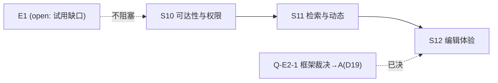

# Notegit E2 GUI 可用性与产品化 Roadmap

---
epic: E2
created: 2026-10-14
basis: 用户裁决（2026-10-14）：DOD-14 缺口收口定案 B——E1 保持 open（试用方落实后追跑），不阻塞 GUI 演进；「GUI 重新思考产品功能并开发，为用户提供更加方便使用的 GUI，可参考其他类似产品」
research: [docs/e2-gui/research.md](../../e2-gui/research.md)（6 竞品调研 + 全页面现状审计 + P0/P1/P2 提案）、[feature-matrix.md](../../e2-gui/feature-matrix.md)；合并 @ cd6eb76
predecessor: [E1](2026-10-12-notegit-v01.md)（S1–S9 merged；14/15 DoD 达标，DOD-14 试用缺口在册）；[docs/s9/next-epics.md](../../s9/next-epics.md) 候选清单
---

## 背景与定位

E1 交付了完整的安全内核（git 唯一真源、三入口一致授权、统一校验、历史/还原/引用、备份恢复）。E2 立项调研（research.md §2）实证：**安全不变量全绿，但「内容生产与发现的表层」存在阻断级缺口**——全站 0 链接可达编辑、无站内新建、检索不命中文件名、读者满屏死按钮、库级历史 diff 链接全 404。E2 的使命：把这些缺口收口，让不熟悉 Git 的员工真正能用起来。

## Deliverables

| id | deliverable | 来源（research.md） |
|---|---|---|
| G01 | 编辑可达性闭环：任一已发布文档 ≤1 跳到达编辑表单 | §2.3 F-1 / P0-1 |
| G02 | 站内新建笔记：浏览器内完成 新建→提交→view 闭环 | §2.3 F-5 / P0-2 |
| G03 | 权限感知呈现：按角色渲染写入口，读者无死按钮 | §2.3 F-2 / P0-4 |
| G04 | 历史链接健康：历史页全部链接可达（含库级 diff 入口修复） | §2.3 F-4 / P0-5 |
| G05 | 全文检索 v1：文件名+正文命中；可见性过滤与截断语义不变 | §2.3 F-3 / P0-3 |
| G06 | 最近变更流（首页/库页，鉴权过滤） | P1-3 |
| G07 | 目录浏览增强：README 渲染为 Markdown、最后提交元数据列 | §2.3 F-8 / P1-4 |
| G08 | 编辑体验：预览、草稿自动保存、「我的草稿」、附件粘贴/拖拽 | §2.3 F-7 / P1-1/2/6 |
| G09 | 顶栏账户菜单与登出 | §2.3 F-9 / P1-7 |
| G10 | 前端框架决策落地（依 Q-E2-1 裁决） | §4 |

## Definition of Done

E2 关闭须逐条附证据链接；部分满足不勾整条。**全部新改页面遵循 [DESIGN.md](../../../DESIGN.md) token 语义（AGENTS.md「UI 样式规范（强制）」），此为每条 DoD 的隐含前提。**

- [ ] **DOD-E2-01 编辑可达性**：view/browse/history/version 页提供「编辑此页」入口；实测任一已发布 `.md` ≤1 跳到达编辑表单（对比现状 F-1：0 链接）。
- [ ] **DOD-E2-02 站内新建**：browse 提供「新建笔记」，服务端直出预填 frontmatter 模板的编辑表单，提交走既有 submissions 端点；不离开浏览器完成 新建→提交→view 闭环。
- [ ] **DOD-E2-03 权限感知呈现**：reader 视角写入口（上传/重命名/删除/编辑/新建）隐藏或明确只读标注，无死按钮；**写操作安全语义不变**（POST 侧全量判定保持——UI 呈现不替代鉴权，D-IC-06/越权测试全绿）。
- [ ] **DOD-E2-04 历史链接健康**：库级与路径级历史页全部链接可达（200/302）；库级 diff 入口修复（对比现状 F-4：两库 3 提交链接全 404）。
- [ ] **DOD-E2-05 全文检索 v1**：文件名与正文关键词命中（不引外部全文引擎——容量约束，api.md §3.6/架构 §9）；可见性过滤（无权库不出现）与 100 截断语义保持；实测 `q=roadmap` 命中 `docs/roadmap.md`（对比现状 F-3：0 命中）。
- [ ] **DOD-E2-06 最近变更流**：首页与库页呈现最近变更（作者/时间/路径链接），按成员关系鉴权过滤。
- [ ] **DOD-E2-07 目录浏览增强**：README 卡片渲染为 Markdown（frontmatter 不外露——对比现状 F-8 `<pre>` 裸奔）；目录行附最后提交时间/作者。
- [ ] **DOD-E2-08 编辑体验**：编辑页渲染预览；草稿自动保存（可配置间隔）；跨库「我的草稿」列表；编辑器内粘贴/拖拽图片自动走附件通道。
- [ ] **DOD-E2-09 框架决策落地**：Q-E2-1 裁决记录 ADR；按裁决完成对应第一步（A=抽公共组件/片段、B=引入并改造 admin/credentials/edit 三页、C=前端工程与门禁面）。
- [ ] **DOD-E2-10 质量与安全回归**：四 gates 全绿；页面域测试随功能增长；research.md §2.2 交叉验证表（未认证 302/无权同 404/CSRF Origin/CAS 409/非法 base 400/reader POST 403）全部保持通过——**UI 改动不得弱化任何安全不变量**。

## Sprint Breakdown

新 epic 使用新 sprint ID（S10–S12），与 E1 的 S1–S9 全局不重复（E1 开工规则 7）。

| sprint | state | note |
|---|---|---|
| S10 | merged | 可达性与权限（G01–G04）；2026-10-14 验收 pass（六场景全绿）并合并 main @ 87ac712——DOD-E2-01~04+10 达标（acceptances/2026-10-14-S10-acceptance.md） | [2026-10-14-S10-plan.md](../sprints/2026-10-14-S10-plan.md)；原始启动裁决：research §5 Sprint A 派生、Orca worker ≤3 superpowers+TDD |
| S11 | merged | 检索与动态（G05–G07）；2026-10-14 验收 pass（六场景全绿）合并 main @ 2c7c67e——DOD-E2-05/06/07/10 达标（acceptances/2026-10-14-S11-acceptance.md）；契约 D 批两笔（检索五面命中/activity 行/storage body 列）；升级注记：存量库需一次索引重建回填 body（acceptance Obstacles） |
| S12 | started | 编辑体验与框架落地（G08–G10）；2026-10-14 go：S11 merged @ 2c7c67e、D19 已定（A 路线）、四要素明确（同 S10/S11 形态）；2026-10-14 started：[2026-10-14-S12-plan.md](../sprints/2026-10-14-S12-plan.md) |

### S10：可达性与权限

**目的**：新用户不读文档即可完成「找→读→改→建」；读者视角无误导入口。

任务：view/browse/history/version 加编辑入口（G01）；browse「新建笔记」→ 预填模板编辑表单 → 既有 submissions 提交（G02）；按角色渲染写入口（G03）；修复库级历史 diff 死链（G04）。

完成标准：DOD-E2-01~04 逐条证据（demo 场景实测 + 测试）；DOD-E2-10 回归全绿。

### S11：检索与动态

**目的**：「找不到内容」与「不知道变了什么」两类抱怨消除。

任务：全文检索 v1——文件名+正文命中、可见性过滤与截断语义不变（G05，实现选型 Q-E2-2 在本 sprint 启动前有方案稿）；最近变更流（G06）；目录浏览增强——README 渲染 + 最后提交列（G07）。

完成标准：DOD-E2-05~07 证据；检索面鉴权测试（无权库零泄露）全绿。

### S12：编辑体验与框架落地

**目的**：编辑-保存-找回心流连贯；前端技术路线定案。

任务：编辑预览、草稿自动保存、「我的草稿」、附件粘贴/拖拽（G08）；顶栏账户菜单（G09）；框架决策落地（G10——依 Q-E2-1）。

完成标准：DOD-E2-08/09 证据；若裁决 C（SPA），前端构建纳入产品门禁并补安全不变量客户端落位测试。

## Decisions (ADR)

ADR 编号接续 E1（D1–D14）。

| id | decision | rationale | date / evidence |
|---|---|---|---|
| D15 | E2 立项：GUI 可用性优先于新能力面；竞品基线 = Outline/Wiki.js/BookStack/Notion/GitLab Wiki/Obsidian Publish 六品实测矩阵 | 用户裁决 B + research.md 实证（安全内核达标、表层阻断缺口 F-1~F-8）；「git 语义呈现」是相对优势保持不动（feature-matrix 相对优势节） | 2026-10-14；research.md §2/§3、feature-matrix.md |
| D16 | Sprint A/B（S10/S11）设计为前端框架无关——服务端渲染 + 既有页面族内演进；框架选型只影响 S12 及以后 | research.md §4 矩阵显示 A/B 方案权衡集中在交互复杂页（edit/admin/credentials）；避免裁决悬置阻塞止损 | 2026-10-14；research.md §4/§5 |
| D17 | 页面域 UI 改动不触碰安全判定：写入口的显示/隐藏只是呈现层优化，POST 侧全量鉴权与 D-IC-06（无权=不存在同 404）不变，独立测试锁定 | 权限感知 UI（P0-4）最大风险是「前端门禁」错觉；E1 DOD-02/03 语义不可回归 | 2026-10-14；research.md §2.2、E1 D1/D3 |
| D18 | 全文检索 v1 不引外部全文引擎：沿用 SQL 派生面（LIKE 扫描或 SQLite 内建能力），容量约束与「索引可重建」原则（架构 §9）不变 | api.md §3.6 明文「不引全文引擎——容量选型」；E1 D7 容量纪律 | 2026-10-14；D18 本行、Q-E2-2 |
| D19 | 前端框架裁决 A（Q-E2-1 closed）：维持纯 SSR + 内联 vanilla JS，零构建链/零外部 JS 依赖不变；重复内联逻辑（api() 封装等）抽为共享 assets 脚本；S12 编辑器功能用原生 fetch 覆盖。回看条件：产品立项实时协作/离线能力时重开（彼时按 C 方案重估迁移成本） | 用户裁决 2026-10-14；research.md §4 矩阵——A 在包体积/构建链/SSR 共存/安全与测试面冲击四维全为 ★ 最优；安全不变量（服务端转义唯一通道/D-IC-06/CSRF）无需迁移 | 2026-10-14；用户裁决、research.md §4 |
| D20 | 全文检索 v1 实现：派生索引扩 body（正文全文）列 + SQL LIKE 子串查询——检索语义与既有元数据面完全同一（ASCII 大小写不敏感、其他文字精确子串，CJK 2 字可命中）；派生/可重建/鉴权逐请求 JOIN 原则不变。FTS5(trigram) 否决：2 字 CJK 查询不可命中（trigram 最小 3 字符）+ 索引约 3 倍正文膨胀；node:sqlite FTS5 可用性已实测但非产品承诺面。回看条件：单库文档数 × 正文规模使 LIKE 实测延迟不可接受（>500ms）时重估混合方案 | research §2.3 F-3/P0-3；api.md §3.6 既有语义延伸；D18 约束（无外部引擎）；CJK 查询习惯（2 字词高频） | 2026-10-14；master 方案稿（FTS5 探测实测 node:sqlite 可用但 trigram 2 字限制致命） |

## Asset Disposition

| asset | disposition | note | date | evidence |
|---|---|---|---|---|
| docs/e2-gui/research.md + feature-matrix.md | reuse | E2 全程基线；竞品行为以「官方文档已核实」条目为准，「未确认」条目不作为验收依据 | 2026-10-14 | cd6eb76 |
| E1 页面族与发布组件 | reuse | 全部新功能走既有端点（submissions/drafts/upload）；不新建平行写通道 | 2026-10-14 | api.md §7/§8/§13 |
| DESIGN.md token 体系 | reuse | 强制（AGENTS.md UI 条款）；S9 样式重制（coral/cream/serif）为现基线 | 2026-10-14 | DESIGN.md、AGENTS.md |
| 契约演进通道 | reuse | draft-first（worker 建议稿 docs/sX/*-amendments.md）+ master D 批模式（D12–D14 先例）；api.md §13 页面行新增走同渠道 | 2026-10-14 | E1 D12/D13/D14 |

## Open Questions

| id | question | status | resolution | date / evidence |
|---|---|---|---|---|
| Q-E2-1 | 前端框架：A 维持纯 SSR+内联 JS / B 轻框架（htmx/Alpine）/ C SPA（React/Vue/Svelte）？ | closed | **2026-10-14 用户裁决 A**：维持纯 SSR + 内联 JS，公共组件抽取（共享 assets 脚本）；D19 入册 | 2026-10-14；research.md §4、D19 |
| Q-E2-2 | 全文检索 v1 实现形态：服务端 LIKE 扫描 / SQLite FTS5 / 派生索引扩列？ | closed | D20：派生索引扩 body 列 + LIKE（语义同一、CJK 2 字可查）；FTS5(trigram) 否决（2 字 CJK 不可命中） | 2026-10-14；D20 |

## Cross-cutting

| concern | note | date |
|---|---|---|
| 安全不变量回归 | 每个 sprint 验收必跑 research.md §2.2 交叉验证表 + E1 e2e-final-regression；UI 层零豁免（D17/DOD-E2-10） | 2026-10-14 |
| 页面域写冲突 | S10 任务按文件所有权切分波次（view/history 域 vs browse/edit 域），避免 web/ 同文件并行冲突（E1 S3/S4 教训） | 2026-10-14 |
| DESIGN.md 一致性 | 验收场景含视觉抽检（token 语义引用、不引入第四表面色、coral 只用于主 CTA/强调卡） | 2026-10-14 |
| 契约纪律 | 页面新端点/新页面 → api.md §13 建议稿渠道；断言禁全等硬编码（E1 后期惯例） | 2026-10-14 |

## 文档维护记录

| date | change | evidence |
|---|---|---|
| 2026-10-14 | E2 立项：依据用户裁决 B 与 research.md；S10–S12 拆分、DoD-E2-01~10、D15–D18 | 本文件；cd6eb76；.agents/notes/2026-10-14-E2-research-settlement.md |
| 2026-10-14 | Q-E2-1 用户裁决 A（纯 SSR+组件抽取）；ADR D19 入册；S12 依赖只剩 S11 | 用户裁决；research.md §4 |
