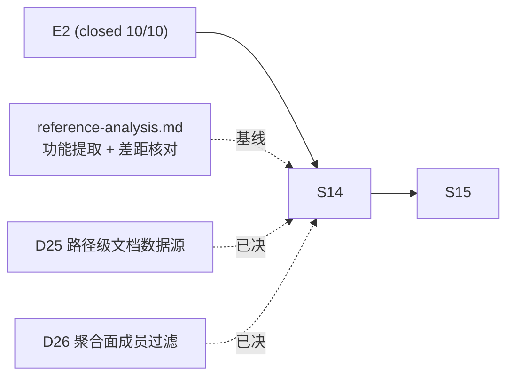

# Notegit E4 工作台化前端 Roadmap

---
epic: E4
created: 2026-10-15
basis: 用户裁决（2026-10-15）：参照 `/Users/jiangwei/Downloads/knowledge-workbench-preview.html` 的**产品功能设计**改造前端，「DESIGN 还是用现有样式」；三项范围裁决 = 全站统一侧栏壳 / 首页原地升级为工作台 / 本轮做响应式两档
direction: **终态方向（用户裁决 2026-10-15）：做「像 GitLab 一样的平台」——Notegit 是未来大量 agent 的底层知识库框架。** 本 epic 的侧栏工作台壳即该平台的容器骨架（GitLab 的多能力共存于同一平台），E4 只做壳与人的工作台面；agent 底座另立 epic（见 §终态方向）。
research: [docs/e4-workbench/reference-analysis.md](../../e4-workbench/reference-analysis.md)（参照稿功能提取 + 与 v0.2.0 的逐项差距核对）
predecessor: [E2](2026-10-14-notegit-e2-gui.md)（S10–S12 merged，10/10 DoD）；[E3](2026-10-14-notegit-e3-site.md)（S13 merged，3/3 DoD）
---

## 终态方向：GitLab 化的 agent 知识底座（2026-10-15 用户裁决）

> 「按照最终变成一个像 GitLab 这样的项目的方向去做，我要这个项目作为未来大量 agent
> 使用的底层知识库框架。」

**方向解读**：GitLab 之所以是 GitLab，不是因为它的 Wiki 做得好，而是因为它是**一个平台
承载多种能力**（仓库 / CI / 议题 / 制品 / Wiki 共用一套身份、权限与审计）。Notegit 的
终态同理——不是「一个给人用的知识库 Web 端」，而是**大量 agent 的底层知识底座**：
人负责策展与治理，agent 负责消费与生产，平台提供稳定的读协议、机器身份、可追溯锚点。

**这个方向与既有基础的契合度（诚实的自评）**——Notegit 现有的内核恰好就是知识底座该有的：

| 底座要件 | Notegit 现状 | 判定 |
|---|---|---|
| 唯一真源 ＋ 可追溯锚点 | Git 为唯一真源；`/cite` 以 commit OID 解析权威 URL | **天然契合**（agent 引用知识必须锚定 commit，这一点已是一等公民） |
| 统一鉴权 ＋ 审计 | 三入口一致 authorize；审计记服务端认证员工（DOD-03，不信 commit 元数据） | **天然契合** |
| 派生索引 ＋ 延迟可观测 | `search_index` / `search_index_state`（lag_ms 可查） | **契合** |
| 人机共用的写通道 | submissions 端点（base_commit CAS、批量 changes） | **契合**（agent 可写，但身份语义待定——见 §缺口 2） |
| **agent 可消费的读面** | 页面为 HTML；JSON 端点仅 `/api/v1/search`（q + 100 截断） | **缺口**（见 §缺口 1） |
| **机器主体身份** | 只有员工主体；agent 只能持员工凭据行事 | **缺口**（见 §缺口 2） |
| **并发与容量** | node:sqlite WAL（多读单写）＋ git http-backend | **待验证**（见 §缺口 3） |

**三个真实缺口（E4 不解决，另立 epic）**：

1. **读协议缺口**（最大）：agent 目前只能消费 HTML——噪音大、token 成本高、无法分页、
   无稳定字段契约。底座必须提供结构化读面（库清单 / 目录树 / 文档元数据 + 正文 /
   批量拉取 / 索引新鲜度查询），且字段契约稳定、错误语义统一（code+message 信封已有）。
2. **身份模型缺口**：现在 agent 持有员工凭据 → 审计记的是员工。这在「少量 agent 辅助人」
   的假设下可接受；在「大量 agent」下会同时撞上两堵墙——**审计不可区分人机**、
   **成员表按 agent 膨胀**。需要裁决：agent 是员工的能力延伸（凭据委托），还是独立的
   机器主体（service account / 委托链）。这是契约与架构级决策，必须先裁决再动手。
3. **容量缺口**：「大量 agent」的并发读、突发写、跨库扇出在现有容量约束
   （api.md §3.6 / 架构 §9）下未实测。底座不能带着未验证的容量假设发布——需要压测与
   索引/缓存策略，而不是先写功能再补测。

**E4 在这个方向里的位置**：侧栏工作台壳 = **平台容器**（GitLab 那种「多能力共存于同一
平台」的骨架），人的工作台面只是第一个入住的能力区。未来 agent 相关区（机器身份管理、
索引状态、用量与审计视图）挂进同一个侧栏——这正是参照稿信息架构的真正价值：它是一个
带分区的工作台，不是一张单页。

**E4 不越界做什么**：不新增 agent 端点、不动身份模型、不做压测。这些属于底座 epic；
E4 只交付壳与人的工作台面，并保证壳的结构不阻碍后续 agent 区入住。

---

## 背景与定位

E2 把「安全内核可用」与「基本能干活」做到了 10/10 DoD：编辑可达、站内新建、权限感知、
全文检索、最近变更、目录增强、编辑体验、共享脚本。E3 补上对外的产品介绍面。

但 E2 的**页面形态仍是「一堆功能页」**：顶栏横向菜单 ＋ 每页各自 `.page` 容器，
首页是一张入口卡清单。它能用，但不像一个工作台——用户登录后看不到「我能去哪、
我有多少、它还活着吗」，跨库的知识流要用三次点击拼出来。

E4 的使命：**把 Notegit 从「功能页集合」改造成「跨库聚合工作台」**。
参照稿给出了成熟答案的信息架构（侧栏分区 ＋ 概览卡 ＋ 库网格 ＋ 路径级文档流 ＋
前置筛选 ＋ 索引新鲜度 ＋ 可见性声明），本 epic 把它落到 Notegit 的真实数据面上。

**样式零变更**：全部新 UI 引用 [DESIGN.md](../../../DESIGN.md) token 语义，不引入
参照稿的调色板/字体/圆角数值（reference-analysis.md §3）。

## Deliverables

| id | deliverable | 来源 |
|---|---|---|
| W01 | 应用壳：顶栏（品牌＋账户）＋左侧分区导航＋内容区；`layout()` 单点升级，全站继承 | §1 IA |
| W02 | 跨库聚合工作台首页（原地升级 `/`）：概览三卡 ＋ 我的文库网格 ＋ 跨库最近文档表 | §2 区块 3/5/6 |
| W03 | 工作台查询面：库文档计数、库最后提交时间、**路径级**最近文档（成员过滤同面） | §4.2 C、D25 |
| W04 | 检索筛选：库筛选 ＋ 状态筛选 ＋ ⌘K 快捷键 | §2 区块 4 |
| W05 | 索引新鲜度指示（消费 `search_index_state`，如实呈现） | §2 区块 2 |
| W06 | 响应式两档断点（≤1020px / ≤680px） | §2 区块 9 |
| W07 | 跨库视图开关（列表/网格）＋ 可见性语义声明位 | §2 区块 7、F |

## Definition of Done

关闭须逐条附证据链接；部分满足不勾整条。**所有新改页面遵循 DESIGN.md token 语义
（AGENTS.md 强制条款），此为每条 DoD 的隐含前提。**

- [x] **DOD-E4-01 应用壳** — S14（acceptance S1/S2：三段壳+侧栏唯一桌面导航+匿名壳原菜单；基线零缺失零漂移）：`layout()` 升级为顶栏＋侧栏＋内容区三段，全站页面继承；
  侧栏承载查找/我的草稿/引用解析/我的凭据/管理五区（管理仍仅实例管理员可见），
  当前区高亮；顶栏保留品牌与账户菜单（登出不回归）。
- [x] **DOD-E4-02 工作台首页** — S14（acceptance S2/S3：三卡/库网格/文档表/事件流次级区块）：`/` 呈现概览三卡 ＋ 我的文库卡片网格 ＋ 跨库最近文档表；
  原三卡入口由侧栏导航吸收，**无链接回归**（全站可达性实测）。
- [x] **DOD-E4-03 工作台查询面** — S14（acceptance S4：聚合面侧信道独立测试锁定——无权库零出现/计数不计入/撤权即消失）：库文档计数、库最后提交时间、路径级最近文档三查询面成立；
  **统计数字与库卡片同源同过滤**——实测无权库的文档数不计入总数、无权库卡片不出现
  （D-IC-06 聚合面延伸，D26）。
- [x] **DOD-E4-04 路径级文档流** — S14（acceptance S5：7 行=4 事件触及路径逐一对应；维护者列如实标注；D30 时钟源）：跨库最近文档表行含文档/所属库/维护者/更新时间；
  路径从事件 commit 的 git diff 派生（不是事件级 audit）；维护者列如实标注来源为
  Git 提交者元数据且**不参与任何权限判定**（D25/DOD-03）。
- [ ] **DOD-E4-05 检索筛选**：`/search` 支持库筛选与状态筛选参数，⌘K/Ctrl-K 聚焦搜索框
  （渐进增强：无 JS 时筛选表单仍可提交）；无权库在筛选器中不出现。
- [ ] **DOD-E4-06 索引新鲜度**：工作台页头呈现索引状态，数据源 `search_index_state`；
  无索引行/失败态如实呈现，**不得出现示意值**。
- [x] **DOD-E4-07 响应式** — S14（acceptance S7：两档断点+<768 兜底保留）：≤1020px 与 ≤680px 两档断点作用于新壳与新工作台页面；
  680px 下侧栏收成图标条、表格按列优先级隐藏，页面无横向滚动。
- [ ] **DOD-E4-08 视图开关与可见性声明**：跨库流支持列表/网格切换；表尾（或等价固定位）
  呈现可见性语义声明（草稿仅创建者可见 · 搜索遵循成员权限）。
- [ ] **DOD-E4-09 质量与安全回归**（S14 份额已达标：四 gates 82/82·7/7·14/14·1007/106/369 + §2.2 实景抽查全绿）：四 gates 全绿；research.md §2.2 交叉验证表
  （未认证 302 / 无权同 404 / CSRF Origin / CAS 409 / reader POST 403）与 E1
  e2e-final-regression 全部保持通过——**UI 与聚合面改动不得弱化任何安全不变量**。
- [ ] **DOD-E4-10 DESIGN.md 一致性**（S14 份额已达标：新区块零内联 hex/coral 纪律/断点在位）：新增样式零内联 hex、全部引用 token 语义；
  不引入第四种表面色；coral 仅用于主 CTA 与整幅强调卡（验收含视觉抽检）。

## Sprint Breakdown

新 sprint ID S14–S15（S1–S13 已被 E1/E2/E3 占用，全局不重复）。

| sprint | state | note |
|---|---|---|
| S14 | merged | 应用壳 ＋ 工作台首页 ＋ 响应式（W01/W02/W03/W06）；2026-10-15 验收 pass（S1–S7 全绿）——DOD-E4-01/02/03/04/07 达标、09/10 S14 份额达标（[acceptance](../acceptances/2026-10-15-S14-acceptance.md)）；D30 时钟源裁决；用户暂停条款履约（T1/T2 后暂停→放行） | [2026-10-15-S14-plan.md](../sprints/2026-10-15-S14-plan.md) |
| S15 | planned | 检索筛选 ＋ 索引指示 ＋ 视图开关与声明（W04/W05/W07） |

### S14：应用壳与工作台

**目的**：全站一个骨架；登录落点即工作台。

任务：`layout()` 三段化 ＋ 侧栏导航（W01，原生 SSR；零构建链不变——D19 延续）；
`/` 原地升级为工作台（W02）；三个新查询面（W03，D25/D26）；两档断点（W06）。

完成标准：DOD-E4-01/02/03/04/06/07/09/10 逐条证据；**导航可达性无回归**实测
（升级前 18 条路由逐条对照，链接零缺失）；聚合面侧信道测试锁定。

### S15：筛选与呈现完善

**目的**：「找不到」与「看不懂」两类抱怨收口。

任务：`/search` 库筛选＋状态筛选＋⌘K（W04）；索引新鲜度指示（W05）；
视图开关与可见性声明位（W07）。

完成标准：DOD-E4-05/06/08 证据；筛选面鉴权测试（无权库在筛选项与结果中零出现）全绿。

## Decisions (ADR)

ADR 编号接续 E3（D1–D23）。

| id | decision | rationale | date / evidence |
|---|---|---|---|
| D24 | E4 立项：采信参照稿的**产品功能设计**，样式全盘沿用 DESIGN.md；参照稿的配色/字体/圆角数值不采信；其业务模块（任务看板、数字员工、工作流、自动化、工件、用量）判定为非 Notegit 能力域、不实施 | 用户裁决「DESIGN 还是用现有样式」；AGENTS.md UI 条款把 DESIGN.md 定为唯一视觉契约；那六个模块属小蓝 CoWork 的业务域，纳入即功能蔓延且无数据面 | 2026-10-15；reference-analysis.md §3、用户裁决 |
| D25 | 路径级最近文档数据源 = **审计事件排序 ＋ git diff 派生路径**：以成功发布事件（可信身份、服务端时间）排序取最近 N 条，再从各事件的 new commit 派生触及路径；维护者列填充 Git 提交者并**如实标注为客户端可填元数据、不作身份判断**（DOD-03 延续）。不新增任何表（延续 D7/D18 派生纪律：数据可从 Git 与审计全量重建） | 现状 activity 面是事件级且 audit `detail` 不写路径，直接用它无法呈现「文档行」；纯路径级方案（search_index 排序）缺可信身份与真实更新时间。排序键必须是服务端审计时间（D-IC-05 精神），路径与作者从 Git 派生；两者职责分离且各自如实标注 | 2026-10-15；reference-analysis.md §4.2 C、web/activity/query.ts 注、DOD-03 |
| D26 | 聚合面的成员过滤与统计口径 = 单一实时 JOIN `vault_members`（与检索/活动同一判定面、无缓存）；统计数字与库卡片同源同过滤，**统计不得成为无权库存在性的侧信道**（D-IC-06 在聚合面的延伸）；以独立测试锁定「无权库文档数不计入总数」 | 概览数字是新引入的聚合呈现面，最易在无意间泄露无权库的存在（数字差值即可反推）；E1 D-IC-06 是既有硬不变量，聚合面必须继承而非豁免 | 2026-10-15；D-IC-06、DOD-E4-03 |
| D27 | 延续 D19（纯 SSR ＋ 共享脚本）：侧栏壳与工作台全部服务端渲染，⌘K 等增强行为进 `/assets/app.js` 共享命名空间，零构建链、零外部 JS 依赖不变 | D19 已在册且回看条件（实时协作/离线立项）未触发；工作台壳本质是服务端渲染问题，引入前端框架成本不划算且冲击安全不变量的实现形态 | 2026-10-15；D19 |
| D28 | **终态方向裁决：Notegit = 面向大量 agent 的底层知识库框架，形态对标「GitLab 式的平台」**（多能力共存于同一平台，共用身份/权限/审计），人负责策展治理、agent 负责消费生产。既有内核（Git 唯一真源 ＋ commit 锚定引用 ＋ 统一鉴权审计 ＋ 派生索引延迟可观测）判定为天然契合底座要件，**三个缺口另立 epic**：agent 可消费的读协议、机器主体身份模型、并发容量验证。E4 边界：只交付平台容器壳 ＋ 人的工作台面，不新增 agent 端点、不动身份模型、不做压测 | 用户裁决 2026-10-15「按照最终变成一个像 GitLab 这样的项目的方向去做」；GitLab 的价值在平台化而非单一能力；既有内核自评契合度高（见 §终态方向表）——缺口如实列明而非承诺在本 epic 一并解决；「大量 agent」是方向不是当前交付物，避免功能蔓延 | 2026-10-15；用户裁决、本文件 §终态方向 |
| D29 | **agent 身份模型裁决：员工能力延伸（凭据委托）**——agent 无独立主体，持「委托凭据」，授权范围为某个员工权限的子集（可读/可写哪些库由委托界定）；审计主体仍是**真实员工**，另标注凭据来源（哪张委托凭据发起）；成员表不因 agent 膨胀。回看条件：需要按 agent 维度统计用量/产出责任，或委托凭据的管理复杂度压过 service account 时，重开独立机器主体模型 | 用户裁决 2026-10-15（E4 立项后即刻拍板）。选此模型的理由：它零改动既有 identity/审计/成员三域（DOD-03「审计主体=认证员工」不变量保持），改动面收敛为凭据作用域列 ＋ 审计标注列；独立 service account 需要改 identity + storage + 契约三域，且成员表按 agent 膨胀问题需另设策略——在读协议尚未落地、agent 规模未验证前不值得付这个代价 | 2026-10-15；用户裁决 2026-10-15；**归属未来「agent 知识底座」epic 落契，本 epic 仅留档不改契约** |
| D30 | **工作台「最后更新」时钟源 = 服务端审计 occurred_at（成功发布事件 MAX），非 git 提交时间**。库卡片 lastCommitAt、汇总 lastContentUpdateAt、路径级文档表 occurredAt 三面同一时钟。docCount 口径 = search_index 行数（与 /search 同源，索引延迟如实呈现——S15 W05）。修订：本表 Asset Disposition 原「web/browse/tree.ts LastCommitInfo reuse」行废止（browse 目录行的作者/时间派生**不受影响**，那是目录浏览场景、逐条目语义） | git %an/%aI 是客户端可填元数据（DOD-03/identity §8）——把它当「最后更新」权威时间等于客户端元数据升格为服务端事实；审计时钟与 D25「排序键只能是服务端审计时间」同源一致；零逐库 spawn。S14-T1 worker 自主选择（两轮 ask 未获回复后按任务书披露不阻塞），master 追认 | 2026-10-15；S14-T1 报告（66f9f33）、master 追认；browse/tree.ts 目录行派生不受影响 |

## Asset Disposition

| asset | disposition | note | date | evidence |
|---|---|---|---|---|
| knowledge-workbench-preview.html | **不入仓**（外部不可信文件） | 仅提取功能设计入 reference-analysis.md；代码/样式/数字一律不复制 | 2026-10-15 | reference-analysis.md |
| docs/e4-workbench/reference-analysis.md | new | E4 全程基线；差距结论逐项附源码依据，不凭印象 | 2026-10-15 | 本文件 |
| DESIGN.md token 体系 | reuse（强制） | 新样式零内联 hex；参照稿调色板丢弃 | 2026-10-15 | DESIGN.md、AGENTS.md |
| web/pages.ts `layout()` | **单点改造核心** | 全站壳的唯一改动点——一次改动全站继承，避免逐页模板分叉 | 2026-10-15 | web/pages.ts:132 |
| web/browse/tree.ts LastCommitInfo | reuse（**仅目录浏览场景**；D30 修订：工作台三面不再走此派生——时钟源改服务端审计 occurred_at） | browse 目录行最后提交作者/时间派生面不变 | 2026-10-15；D30 |
| web/activity/query.ts | reuse（扩） | 审计事件排序面已在位；路径派生为新增只读查询面 | 2026-10-15 | web/activity/query.ts |
| search_index / search_index_state | reuse | 索引新鲜度与标签 chips 的数据源；派生可重建原则不变 | 2026-10-15 | 迁移 0009/0010 |
| 契约演进通道 | reuse | draft-first ＋ master D 批（D12–D14/D21–D23 先例）；新页面参数/端点走 api.md §13 建议稿渠道 | 2026-10-15 | E1 D12–D14 |

## Open Questions

| id | question | status | resolution | date / evidence |
|---|---|---|---|---|
| Q-E4-1 | 「全部文库」聚合卡点击行为：跳现有 `/vaults` 列表页 / 独立跨库筛选态？ | proposed | 跳 `/vaults`（=筛选态的自然等价，且不新建第二份库列表）；若 S14 实测中跨库流已覆盖该诉求则维持 | 待 S14 启动前裁决 |
| Q-E4-2 | 跨库最近文档表是否混入草稿行（参照稿有草稿行）？ | proposed | **不混入**：主表只呈现已发布（跨库知识流语义纯净），草稿以计数卡/入口链到 `/drafts`——混合两态会让「已发布知识」这一表的核心语义失真，且草稿本就只有作者可见 | 待 S14 启动前裁决 |
| Q-E4-3 | ⌘K 是全局快捷键（任意页面唤起搜索）还是仅 `/search` 页内？ | proposed | 仅 `/search` 页内（零 JS 渐进增强下全局快捷键需每页挂监听，且收益集中在搜索页） | 待 S15 启动前裁决 |
| Q-E4-4 | agent 在 Notegit 里是什么身份？ | **closed** | **凭据委托**（D29）：agent 无独立主体，持委托凭据，授权为员工权限子集；审计主体=真实员工 ＋ 标注凭据来源；成员表不膨胀。归属未来底座 epic 落契 | 2026-10-15；D29、用户裁决 |

## Cross-cutting

| concern | note | date |
|---|---|---|
| 安全不变量回归 | 每个 sprint 验收必跑 research.md §2.2 交叉验证表 ＋ E1 e2e-final-regression；UI 与聚合面零豁免（DOD-E4-09） | 2026-10-15 |
| 聚合面侧信道 | 统计数字/计数/筛选项的无权库泄露为**新增风险面**，测试须显式覆盖而非顺带通过（D26） | 2026-10-15 |
| 导航可达性回归 | `layout()` 是全站单点——一次改动波及每一页；升级前后 18 条路由链接逐条对照 | 2026-10-15 |
| 页面域写冲突 | `web/pages.ts` `layout()` 为高冲突文件（W01 独占）；查询面模块（workbench/query.ts）由另一任务持有，避免同文件并行 | 2026-10-15 |
| DESIGN.md 一致性 | 验收场景含视觉抽检（token 语义引用、无第四表面色、coral 仅主 CTA/强调卡、零内联 hex） | 2026-10-15 |
| 契约纪律 | 新查询面/新页面参数 → api.md §13 建议稿渠道；断言禁全等硬编码（E1 后期惯例） | 2026-10-15 |

## 文档维护记录

| date | change | evidence |
|---|---|---|
| 2026-10-15 | E4 立项：参照稿功能提取（reference-analysis.md）＋ 与 v0.2.0 逐项差距核对；S14/S15 拆分、DoD-E4-01~10、D24–D27；用户三项范围裁决入册 | 本文件；reference-analysis.md；用户裁决 2026-10-15 |
| 2026-10-15 | S14 merged（DOD-E4-01~04/07 + 09/10 份额）；D30 时钟源；暂停条款履约与放行 | acceptance/2026-10-15-S14 |
| 2026-10-15 | **终态方向入册（D28）**：GitLab 式平台 ＋ agent 知识底座；既有内核自评契合度表 + 三缺口（读协议/机器身份/容量）另立 epic；E4 边界收窄为「壳 ＋ 人的工作台面」 | 用户裁决 2026-10-15；本文件 §终态方向 |
