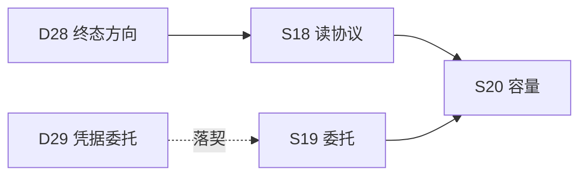

# Notegit E6 Agent 知识底座 Roadmap

---
epic: E6
created: 2026-10-16
basis: 用户终态方向裁决（2026-10-15，E4 D28）：「按照最终变成一个像 GitLab 这样的项目的方向去做，我要这个项目作为未来大量 agent 使用的底层知识库框架」；用户指令（2026-10-16）「完成后，你继续推进后续工作」——E4/E5 收口后自主推进本线
predecessor: [E4](2026-10-15-notegit-e4-workbench.md)（工作台壳与功能，D28/D29 留档）、[E5](2026-10-15-notegit-e5-visual.md)（视觉 v2）
---

## 背景与定位

E4 roadmap §终态方向已论证：Notegit 内核（Git 唯一真源 ＋ commit 锚定引用 ＋ 统一鉴权审计
＋ 派生索引）天然是 agent 知识底座的要件，缺口三：**读协议**（agent 只能吃 HTML）、
**身份模型**（D29 已裁决=凭据委托，未落契）、**容量**（「大量 agent」并发未实测）。

本 epic 把三个缺口逐一落地：agent 用稳定字段契约的 JSON 读面消费知识、用带作用域的
委托凭据行事（审计主体仍是员工）、平台带着实测容量底线发布。人面（工作台）已在 E4/E5
交付；本 epic 全部是**机器面**。

## Deliverables

| id | deliverable |
|---|---|
| R01 | 结构化读协议 v1：库清单 / 目录树 / 文档（frontmatter 元数据+原始正文+commit 锚）/ 索引状态——字段契约稳定、错误信封统一（既有 code+message）、可见性判定与检索同一面 |
| R02 | 凭据委托落契（D29）：委托凭据作用域（库×读/写，员工权限子集）＋ 审计标注凭据来源 |
| R03 | 容量验证：并发读 / 突发写 / 跨库扇出实测底线与数字入档（docs/e6/capacity.md） |
| R04 | 契约与文档：api.md §3 新端点行落契；agent 消费指南（docs/e6/agent-guide.md：认证/引用锚定/变更感知） |

## Definition of Done

- [x] **DOD-E6-01 读协议** — S18（四端点稳定 JSON；Bearer 全链+锚定差异实证；scope 收窄实景生效）：四端点（vaults 清单 / tree / docs / index-status）稳定 JSON；
  实测 agent 场景——匿名 401、bob 无权库 404 与不存在同形态、commit 锚定读取
  （ref=OID 与 version 页同一树）、截断与分页语义如实标注。
- [ ] **DOD-E6-02 凭据委托**：委托凭据签发（作用域=员工权限子集）/ 撤销 / 越权拒绝
  （作用域外 404 同形态）；审计行携带凭据来源标注；员工撤权 → 委托即失效（不缓存）。
- [ ] **DOD-E6-03 容量验证**：三场景（并发读 / 突发写 / 跨库扇出）实测数字与底线结论
  入档；发现的瓶颈如实记录（不粉饰、不过度优化）。
- [x] **DOD-E6-04 契约与指南** — S18 份额（api.md §6 三行+§1 E-RES-009+§5 增量；agent-guide 骨架）：api.md 新端点行落契（draft-first → master D 批）；
  agent-guide.md（认证/锚定引用/变更感知/礼貌轮询建议——索引状态端点即为此设计）。
- [x] **DOD-E6-05 安全回归** — S18 份额（S3 侧信道逐字节同体+四 gates）；epic 级随 S19/S20 复验：四 gates 全绿；§2.2 交叉验证表 + e2e-final-regression 保持；
  新读面不得成为侧信道（无权库零出现——与检索/工作台同一判定面，独立测试锁定）。

## Sprint Breakdown

| sprint | state | note |
|---|---|---|
| S18 | merged | 读协议 v1；2026-10-16 验收 pass（agent Bearer 全链实景跑通、锚定差异实证、四 gates 1070/106/369）——DOD-E6-01/04/05 份额达标；Q-E6-1 定案（全量+截断）；契约 D 批四笔（[acceptance](../acceptances/2026-10-16-S18-acceptance.md)） | [2026-10-16-S18-plan.md](../sprints/2026-10-16-S18-plan.md) |
| S19 | planned | 凭据委托（R02）：作用域列+签发撤销面+审计标注+越权测试 |
| S20 | planned | 容量验证（R03）：三场景实测+结论入档+瓶颈清单 |

## Decisions (ADR)

| id | decision | rationale | date / evidence |
|---|---|---|---|
| D35 | E6 立项：机器面（读协议/委托/容量）三缺口按序落地；人面（工作台）不在本 epic 范围（E4/E5 已交付） | D28 方向的最短落地路径；读协议先行（agent 当期最大痛点），容量殿后（验证前两者形态） | 2026-10-16；D28、用户指令 |
| D36 | 读协议形态：**资源型 GET JSON**（/api/v1/vaults、/vaults/{slug}/tree[?ref=]、/vaults/{slug}/docs/{path}[?ref=]、/vaults/{slug}/index-status），正文=**原始 Markdown**（frontmatter 剥离与否双字段给全），元数据复用 search_index 派生面；错误信封沿用既有 code+message；ETag=commit OID（协商缓存——内容即 commit 锚定） | agent 要原文自己渲染（不预设消费方渲染栈）；commit OID 天然是内容哈希语义（S16 缓存热修同构）；复用派生面零新真源 | 2026-10-16；D36 本行 |
| D37 | 读协议认证=既有凭据/会话同一缝（identity §5.1）；本 sprint 不做作用域（S19 落）——**接口面预留但不实现 scope 字段**，避免半成品语义 | 三入口一致授权不变量优先；S19 独立落契避免契约半迁移 | 2026-10-16；D29/D37 |
| D38 | docs 端点 ref 参数：缺省=默认分支 HEAD；ref=OID 走 version 页同一树（历史 blob 鉴权同源）；ref=分支名不支持（v1 只 commit OID——与 /cite 引用格式对齐，避免分支漂移锚） | 引用锚定是底座核心承诺：分支名会漂移，commit 不会 | 2026-10-16；/cite 三要素、架构 §7.1 |

## Open Questions

| id | question | status | resolution | date / evidence |
|---|---|---|---|---|
| Q-E6-1 | tree 端点分页/截断上限（单库大目录）？ | closed | v1 = 全量树 + 上限告警字段（truncated: true——与 search 100 截断同哲学）；实测超限库再议分页 | **S18 定案：全量+1000 截断 truncated 如实（不预设分页）** | 2026-10-16；S18 acceptance |
| Q-E6-2 | CLI 是否同步加只读命令（clone 已有）？ | proposed | 不加——agent 走 HTTP；CLI 人用形态不变（保持最小） | 待 S19 后重估 |

## Cross-cutting

| concern | note | date |
|---|---|---|
| 侧信道 | 新读面全部与检索/工作台同一实时 JOIN 判定面；bob 视角逐端点测试锁定 | 2026-10-16 |
| 契约纪律 | 新端点行 draft-first（docs/s18/api-amendments.md）→ master D 批落 §3 | 2026-10-16 |
| 写面不动 | S18/S19 零写通道变更（submissions 语义不变——agent 写=既有端点+凭据） | 2026-10-16 |

## 文档维护记录

| date | change | evidence |
|---|---|---|
| 2026-10-16 | E6 立项：R01–R04、DOD-E6-01~05、S18–S20、D35–D38 | 用户终态方向（2026-10-15）+「继续推进后续工作」指令（2026-10-16）；本文件 |
| 2026-10-16 | S18 merged（DOD-E6-01/04/05 份额）；Q-E6-1 closed；契约 D 批四笔 | acceptance/2026-10-16-S18 |
